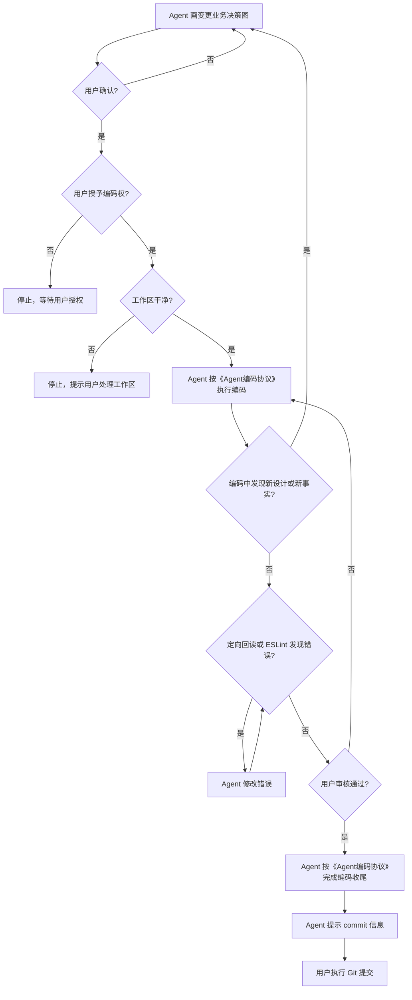

# 复杂任务协作协议

## 一、阶段

复杂任务只包含三个阶段：

1. 需求分析阶段
2. 任务拆分阶段
3. 编码阶段

每个阶段由用户主动开启。Agent 不主动推进阶段，不要求更换对话，不因阶段变化擅自编码。用户可以在同一对话或不同对话中开启任意阶段。

## 二、需求分析阶段

需求分析按固定顺序完成：
1. 用户想要什么
2. 现状是什么
3. 推荐的候选方案


### 1. 用户要什么

用户只负责说明主观上想要什么。

用户对客观事实的描述只作为调查线索，不作为事实依据。

### 2. 现状是什么

Agent 只调查与本次目标直接相关的实际行为，并将代码、数据、接口、配置等实现介质抽离成业务决策后反馈给用户。

现状不是代码说明，不得用类名、方法名、表名、字段名和配置项代替业务决策。

范围内的每个业务决策都必须上报，不得因为代码上显而易见而遗漏。一个分支只要会改变业务结果，就必须成为一个业务决策。

现状和改动必须分开描述。现状只说明系统现在做了什么，不混入准备怎么改。

现状必然是动态链路，必须用 Mermaid 串联直接相关的上游、当前和下游业务决策。

### 3. 推荐的候选方案

Agent 在已确认的现状上给出候选方案，只说明：

- 方案会改变哪些业务决策
- 对现有行为和用户结果的影响
- 代价和取舍
- 推荐方案及原因

用户确认方案后，需求分析阶段结束。

## 三、Mermaid 标准

### 何时画图

现状或改动只要存在动态业务链路，就必须画 Mermaid。

没有动态链路的范围不画图。

### 图的边界

一个决策域画一张图。

同时满足以下条件的业务决策属于同一决策域：

- 由同一类入口触发
- 使用同一组业务输入
- 作用于同一业务对象或状态
- 形成同一条业务结果链

入口、输入、业务对象或结果链发生变化时，拆成新图。

上下游中只有直接影响该决策域的决策才画。无关上下文不画。

### 图的内容

图中只能出现业务动作、业务决策和业务结果。

同一决策域内的所有业务决策必须完整出现。

每个决策必须写清：

- 判断条件
- 所有分支
- 各分支结果
- 用户或调用方最终看到什么
- 循环何时继续、何时结束
- 无数据、达到上限和系统错误是否不同

正常路径和异常路径必须同时绘制，不得只画成功路径。

异常路径必须写清触发条件、处理动作和最终结果。

### 现状图和变更图

现状业务决策画成现状图，子任务准备改变的决策画成变更图。

两者用途不同，不得合并成一张图。

变更图只呈现该子任务会改变的业务决策，并显示改动后的完整决策链。

需要删除的业务能力、分支或结果必须作为变更决策显式保留，不得因变更后不再存在而从图中省略。

变更图必须使用文本后缀标识本次改动：

- 现状不存在的业务能力标记为 `（新增）`
- 现状存在但业务行为发生变化的标记为 `（更新）`
- 现状存在但变更后不再保留的业务能力、分支或结果标记为 `（删除）`

`（删除）` 必须说明删除的具体内容和删除后由什么路径承接；无替代时明确写出“无替代”。

未修改能力不标识，现状图禁止使用这三个标识。

## 四、任务拆分阶段

需求分析确认后，再拆分任务。

每个子任务必须能够独立完成以下闭环：



任务有两种拆法：

1. 存在依赖顺序时，按依赖顺序拆成串行子任务。
2. 改动过大且互不依赖时，拆成无依赖子任务并自行确定执行顺序。

## 五、编码阶段

每个子任务严格按任务拆分阶段的闭环图执行。

编码实现、注释和定向校验按《Agent编码协议》执行。

Agent 不执行提交，不增加审核、复述、汇报等额外动作。

### Commit 信息

Commit 信息只使用以下格式：

```text
feat: <简短中文总结>
fix: <简短中文总结>
```

功能增加使用 `feat:`，行为修复使用 `fix:`。

## 六、任务文档

写入时机：进入下一阶段时。

写入内容：只写入最终结果。

严禁追加中间过程、流水账、讨论记录和说明性文字。

每项复杂任务只保留一份当前任务文档，不保留历史版本。

任务文档只记录已确认结果：

```text
# 任务名称

## 1. 用户想要什么

## 2. 现状业务决策

<!-- 存在动态链路时附 Mermaid -->

## 3. 被采纳的方案

候选方案禁止写入

## 4. 子任务

### 子任务 N

目标：

依赖：

变更业务决策：

<!-- 存在动态链路时附 Mermaid -->
```

没有的内容直接不写，不填写“无”。

不写代码删除汇报。

## 七、汇报规则

1. 只有用户明确要求生成、重写或整理汇报时才使用本节规则，不主动生成汇报。
2. 汇报只写两部分：先写“现在有什么问题”，再写“怎么做”。不写结论、目标、背景、预期结果、收益、候选方案、风险、流水账或任务完成总结。
3. “现在有什么问题”必须说明实际行为，并带上对应类名；必要时补充文件或方法名，让读者能直接回代码核对。不得只写抽象判断。
4. “怎么做”直接写动作、触发时机、判断条件和结果，使用现有代码、表、字段和业务对象名称。禁止给普通实现包装新概念或先定义概念再解释；例如不要写“Redis 代际/版本号”，直接写“某动作完成后，把 Redis 中保存的一个整数原子加一”。能用实际组件名称时，不使用含混称呼，例如说 `admin-service`，不说“管理端”。
5. 正文按重要程度分三档：一档使用 `<font color="red">文字</font>`，二档使用 `**文字**`，三档保持普通文字。强调只标需要优先看到的结论、影响或关键动作，不整段标红或加粗；Markdown 没有标准颜色语法，统一使用上述 HTML。

## 八、完成

所有子任务均已提交后，任务立即完成。

不再执行验收汇报、完成总结、代码删除汇报或其他收尾动作。
