# MySQL

## MySQL 的三层主线

MySQL 骨架：

1. **SQL 如何表达需求。** 开发者用 SQL 的语法写出查询、更新、排序和连接；语法让 MySQL 能读懂语句，关系语义则规定结果必须满足什么条件。
2. **Server 层如何选择访问计划。** Server 层完成连接与权限检查、解析 SQL，并在不改变关系语义的前提下，依据统计信息和可用索引选择扫描、连接、排序等访问计划。
3. **存储引擎如何实现计划。** InnoDB 接收计划中的访问请求，将其落实为 B+ 树定位、记录可见性判断、内存页读写、并发控制和持久化文件修改。

除主骨架外的其他能力：
1. 连接、权限和结果集协议支撑 Server 层
2. 事务、锁、日志、复制与运维分别保证计划执行、数据正确性和系统可用性

### Server 层与存储引擎边界

Server先理解SQL，再告诉存储引擎怎么执行SQL
1. Server 层：
   - 包括连接管理、权限检查、SQL 解析、优化器和结果集协议 
   - Server 层先把 SQL 转成逻辑上必须完成的操作，再根据统计信息和可用索引选择执行计划
   - 执行计划中的扫描某个索引、按连接键查找另一张表等动作，通过存储引擎接口变成对 InnoDB 的请求
2. 存储引擎：
   - 包括：表的页、索引、事务和持久化。
   - InnoDB只负责接受Server层的请求，并将请求落实为B+ 树定位、页读取、记录可见性判断和必要的修改持久化

Server 层与存储引擎的边界
- Server层和存储引擎的分工：例如索引同时影响优化器的选择，和InnoDB的页面访问。
- 计划显示的访问路径属于 Server 层优化决策，实际耗时还要看 InnoDB 是否需要回表、页面是否在缓存中、锁是否造成等待

总结：**SQL 先被 Server 层解释为逻辑操作 -> 优化器选择物理计划 -> 存储引擎将计划落实为页和记录访问 -> 两层共同决定结果与成本。** 

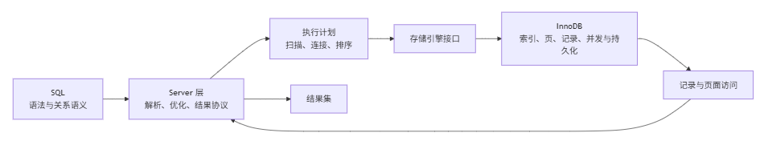

## 数据载体：InnoDB 如何组织与保存记录

### 一行数据如何成为页内记录

记录为了支持按键查找和事务版本判断，由记录头+表中一行的字节编码组成
- 记录头：保存状态和同页下一条记录的线索；可空列与变长列需要额外元数据来划出边界；事务 ID 和回滚指针则为可见性判断与寻找旧版本留下入口
- 记录实际占用空间不仅由表中每一行的字节编码长度决定，也受`NULL`、变长列和版本信息影响；
  - `TEXT`、`BLOB` 等大字段无法完整放进普通记录空间时，主体可能转到溢出页，主记录只保留必要的前缀或定位信息。读取完整字段便多了一段页面访问，更新也可能涉及更多页面。

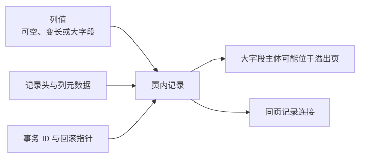

### 页为什么是读取、缓存与写回单位

页是 InnoDB 在持久化文件与内存之间搬运、缓存和写回的基本单位.
- 读一行时，先检查包含它的页是否在 Buffer Pool；
- 未命中：载入整页
- 命中：在内存页中找到记录
- 更新：先修改内存页，使它成为脏页，之后再由后台流程写回文件。

访问成本的直接来源：一次扫描需要跨越多少页、这些页是否已缓存

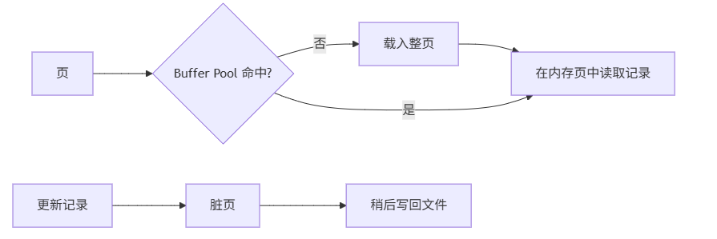

### 记录宽度如何改变表设计

页可用空间近似固定

记录越宽，同一页能装的行越少
- 扫描相同数量的行时，需要跨越更多页，消耗更多 Buffer Pool，也更容易产生 I/O

记录越窄，若某些字段几乎总与主记录一起读取，强行拆分会让每次查询增加连接或额外查表

设计表：
- **低频的大字段拆到详情表，能让热点列表页更紧凑**
- 稳定且较窄的主键的额外价值：二级索引叶子项携带聚簇键，宽主键会把空间与维护成本传播到每个二级索引

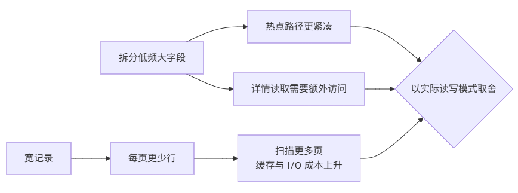
### 页内如何定位记录

索引只能根据键值将查找指向记录所在叶子页，由页目录+记录头定位记录在页的哪个位置；
- InnoDB把页内有序记录分成若干小组，每组有一个作为边界的记录，页目录只保存这些边界记录的位置。
- **页内记录需要保持有序 -> 全页逐条比较太慢 -> 只索引少量组边界 -> 先在目录中选组、再沿记录连接查找。**
- 行记录的页内连接并非仅用于顺序遍历，它还是页目录完成局部查找后的最后一段访问路径。

## 索引路径：如何从一个键到达一行

### 一张 InnoDB 表在索引页中怎样存在

前一模块已经建立了两个事实：
- 记录是表中一行的物理编码
- 页是记录被读取、缓存和写回的单位

索引同样由许多页组成；不同的是，**索引页**把记录按键值组织起来，并用上层页指向下层页。

InnoDB 一张表通常同时有两类索引结构。
- 聚簇索引按主键组织，叶子页直接保存完整记录，因此它既是主键索引，也是表数据的主要物理组织。
- 二级索引按另一个查询键组织，叶子页只保存二级键与对应的聚簇键；它必须用聚簇键指回聚簇索引，才能抵达完整记录。

下图是静态结构：两棵树的内部页都只负责按分隔键向下指页；真正的差异在叶子页保存的内容，以及二级索引项指向聚簇键的关系。

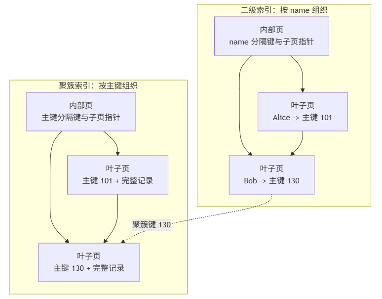

### 查询如何沿索引结构取得结果

静态结构确定后，查询只是在其中选择一条路径。
- 主键查询在聚簇索引内部页逐层下行，到叶子页即取得完整记录
- 二级索引查询先在二级树中找到聚簇键，若需要的列不在二级索引项中，再进入聚簇索引取得完整行，这第二段就是**回表**。

**若二级索引叶子页已经包含筛选、排序和返回结果所需的列，查询可以直接从该叶子页构造结果，称为覆盖索引**
- 这省掉回表的数据页访问，但会让二级索引更宽、写入时维护更多内容。

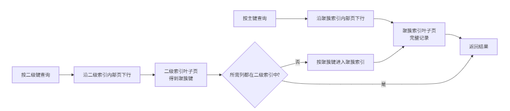

### 联合索引如何形成连续范围（未学习）

联合索引不是几列索引的并列组合，而是一条按列序字典排序的键流。
- 对于 `(a, b, c)`，先固定 `a` 才能在对应的连续区间内继续用 `b`；再固定 `b`，才可能进一步缩小 `c`。
- 这就是**最左匹配**的来源：不知道最左列时，后续列的相同值分散在许多不同区间，不能直接形成一段树路径。

等值条件通常把起点压缩到很小的区间；范围条件给出起点和终点，却仍需要沿叶子页扫描其中的项目。`ORDER BY` 只有与这条索引顺序兼容时，才能边读边输出；前置列缺失、过早出现范围、函数包裹列或排序方向不匹配，都可能扩大扫描或引入额外排序。

设计联合索引时，应从一组高频查询同时观察过滤、排序、返回列和写入代价，而不是为每个被引用的列机械建索引。

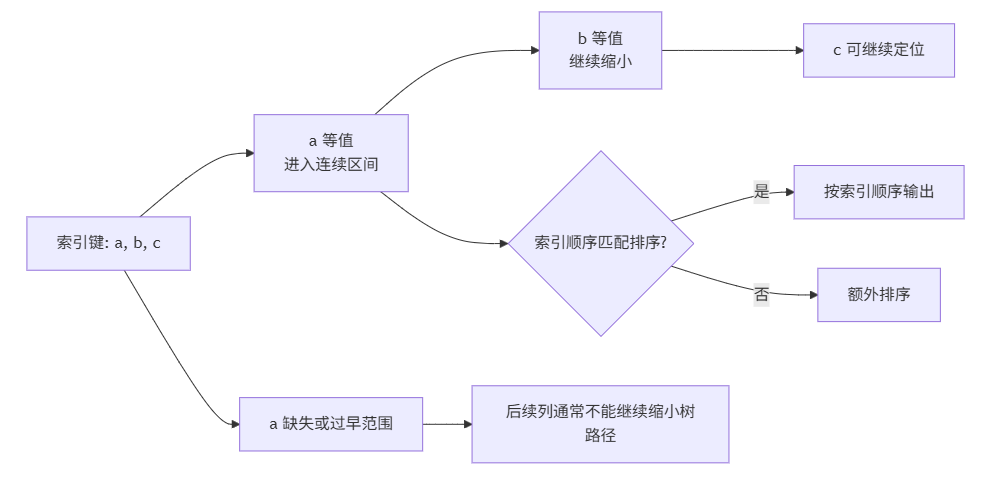

### 索引路径什么时候不再划算（未学习）

索引的价值在于少读页，而不是“只要命中索引就会更快”。低选择性条件或过大的范围仍会扫描大量索引项；如果结果还要回表取得宽行，分散的数据页访问可能比顺序扫描整表更贵。统计信息过期、数据分布变化和缓存状态变化，也会使同一条索引路径在不同参数下产生不同成本。

索引条件下推提供了一个局部补救：当过滤条件引用索引记录中已有的列时，InnoDB 可以在返回候选行或回表前先判断条件，丢弃不满足的索引项，从而减少回表和上层处理行数。但它不会改变 SQL 的关系语义，也不能让缺少索引列的条件凭空变成树上的连续定位。

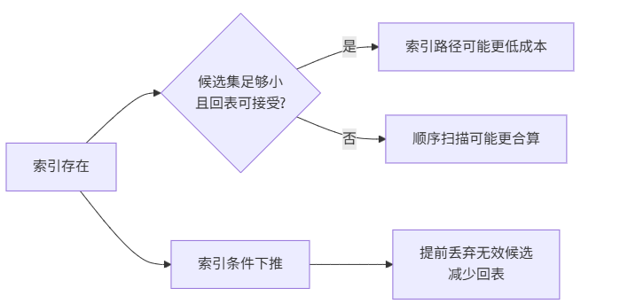

## 查询选择：优化器如何安排访问

### 逻辑执行与物理访问路径(未学习)

SQL 描述的是“要什么结果”，而不是“怎样从磁盘和内存取到结果”。例如 `WHERE` 规定哪些行可以留下，`JOIN` 规定哪些行应当配对，`ORDER BY` 规定结果顺序；这些是逻辑语义。只要最终结果相同，数据库可以用不同的扫描方式、不同的表连接顺序和不同的排序策略完成它。

优化器把逻辑语义翻译为候选物理路径：它可以顺序扫描全部数据页，也可以先扫描索引页再回到聚簇索引；连接时可以先读取任意一侧，再用另一侧的索引逐行查找；排序若与索引顺序兼容，可以边读边输出，否则就要收集结果并排序。选择哪条路径，取决于索引可用性、条件的选择性、统计信息估计、返回列以及内存和 I/O 成本。

因此，同一条 SQL 在小表上可能顺序扫描更便宜，在大量无关记录中可能索引访问更合算；同一张表也会因参数不同而选择不同路径。核心推导链是：**SQL 固定结果语义 -> 优化器枚举等价的物理做法 -> 每种做法访问不同数量和类型的页 -> 成本模型选择预期代价较低的一条。** 这把前两节的页、索引、回表关系连接到执行计划：执行计划不是另一套语法，而是“为了得到同一逻辑结果，实际选择了哪条物理路径”的证据。

执行计划也会留下可继续追问的线索：看到全表扫描，应问索引路径为何不划算；看到二级索引访问，应问候选行是否过多、是否发生回表；看到额外排序，应问索引顺序为何不能直接满足结果顺序。每个问题都回到页、索引和数据分布，而不是停留在“是否用了索引”的表面判断。

优化器只能根据当时的统计信息和成本模型做估计。统计信息过期、数据倾斜、缓存状态、并发负载和 MySQL 版本变化都可能改变实际表现；因此，执行计划用于提出和验证假设，不能被当作脱离运行条件的永久结论。

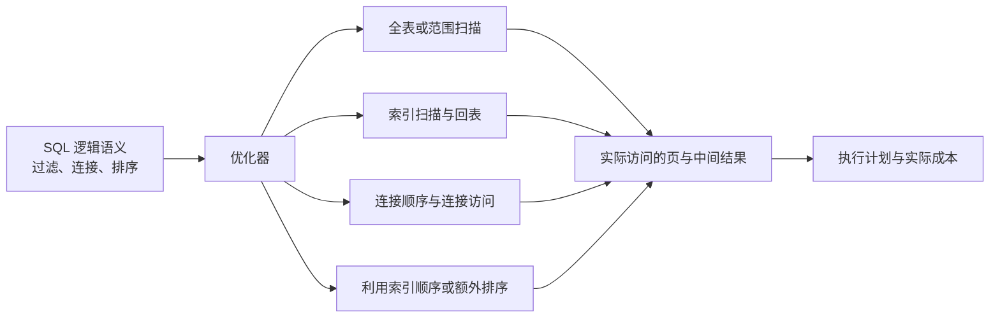

### Join 的索引访问（未学习）

1. 目标：理解连接两侧如何借助索引减少匹配成本。
2. 前提：连接算法需要从一侧取得行，并按连接键查找另一侧候选行。
3. 推导 1：被驱动表连接键有索引时，可对每个外表键执行定点或范围查找。
4. 推导 2：缺少合适索引时，连接可能反复扫描大量记录或构建哈希、排序结构。
5. 结论：连接索引应结合驱动顺序、连接选择性和返回列设计。
6. 边界：优化器可交换驱动顺序或选择其他连接算法，不能只看 SQL 表书写顺序。

### 排序与临时表（未学习）

1. 目标：判断查询何时可以利用索引顺序，何时需要额外排序或临时表。
2. 前提：ORDER BY、GROUP BY 的键顺序与可用索引顺序可能一致或不一致。
3. 推导 1：顺序兼容时可按索引扫描输出，避免独立排序。
4. 推导 2：顺序不兼容或需要中间聚合时，数据库可能建立临时结构并执行排序。
5. 结论：排序和临时表成本取决于输入行数、内存和索引顺序匹配度。
6. 边界：临时结构可能在内存或磁盘中实现，执行计划和数据规模决定具体路径。

## 索引取舍：如何设计并诊断访问成本

### 为什么加索引后仍然很慢（未学习）

索引的价值在于少读页，而不是“只要命中一个索引就会更快”。低选择性条件或很宽的范围仍会扫过大量索引项；若结果还要回表取得宽行，这些随机的数据页访问可能比顺序扫描整表更贵。优化器因此可能合理地放弃一个存在的索引。

排查要从计划中的候选行、实际行数、回表和额外排序开始，再回看统计信息、参数分布和缓存状态。它们变化时，同一索引对不同查询甚至同一查询的不同时刻都可能有不同收益。

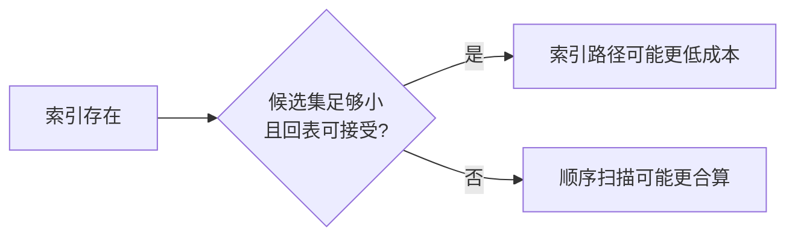

### 为什么回表成为瓶颈（未学习）

二级索引先给出候选的聚簇键，查询需要其他列时，候选项每增加一个，就多一次进入聚簇索引的机会。候选行分散在许多数据页时，回表会把一次看似连续的索引扫描变成大量分散页访问，并挤占 Buffer Pool。

先缩小候选集通常比盲目扩宽索引更有效；只有读收益足以覆盖额外存储和写维护成本时，才考虑用 [找到索引项后，如何找到完整记录](#找到索引项后如何找到完整记录未学习) 中的覆盖索引思路去掉这条路径。

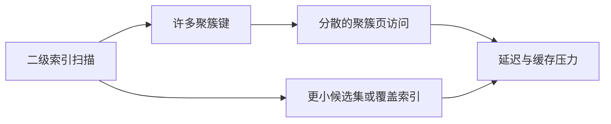

### 为什么联合索引顺序错误（未学习）

当执行计划显示联合索引已经被使用，却仍扫描大量索引项或出现额外排序时，问题通常不在“有没有索引”，而在索引顺序没有把这条查询需要的连续前缀放在前面。诊断时先对照查询的等值条件、范围条件和排序，再检查哪一列过早截断了树定位；不要把“SQL 引用了某列”误认为“该列参与了高效定位”。

这里的修正应服务于一组真实查询。为某一条语句调整顺序，可能损害另一条语句；最终还要比较候选行数、回表、排序和写入维护成本。

### 如何根据执行计划调整索引（未学习）

索引调整应形成一个可验证的闭环：先从执行计划和实际运行信息定位扫描范围、估算偏差、回表或排序等主要成本；再根据查询谓词、返回列和工作负载提出索引顺序或覆盖范围的假设；最后比较修改前后的计划与实际成本。

执行计划是证据，不是结论。单次计划不能代表所有参数、数据分布和并发场景；如果估算与实际行数差异很大，还应优先检查统计信息，而不是立即增加索引。

## 写入与持久化：修改如何保持有序且可恢复

### 页分裂与页合并(未学习)

一张索引页既要保存有序记录，又只有固定容量。向中间插入新键时，目标页可能已经没有足够空间；直接把新记录放到别处会破坏键值顺序，而顺序一旦破坏，范围扫描和索引检索就失去可靠的访问路径。

页分裂是为保持顺序付出的结构调整：InnoDB 申请一个新页，把原页中的一部分记录移过去，使两个页各自仍按键值有序；随后父层需要知道两个页之间新的分界键，才能把后续查找导向正确页。一次普通插入因此可能牵连多个页面、父层索引项和日志记录。主键持续递增时，新记录大多落在末尾页，分裂集中在增长边界；键值随机插入时，多个已存在的页都可能成为分裂目标，局部页利用率和写入成本更难预测。

删除也留下相反的问题：记录移走后，页可能长期过于稀疏，范围扫描需要跨越更多页。引擎可以在合适时机让相邻页合并，或在页间重新分配记录，以回收空间并维持合理密度。它并不意味着每次删除都会立即合并，因为立即整理本身也需要写入、加锁和日志成本。

核心推导链是：**页容量固定且记录必须有序 -> 插入满页或删除稀疏页 -> 在相邻页之间搬迁记录并更新分界关系 -> 保住检索顺序，同时产生写放大与碎片风险。** 这里与联合索引和聚簇索引存在一条因果连接：它们决定记录按什么键值顺序聚集，因而也决定哪些写入会集中命中同一批页；具体如何选择索引键，则是由这条页级代价自然引出的下一问题。

分裂、合并和重分配的触发时机受页填充情况、写入模式和 InnoDB 实现策略影响，不能从一条 `INSERT` 或 `DELETE` 直接断言发生了哪种调整。分析实际问题时，需要把页级现象与写入键分布、索引数量和运行时指标结合起来。

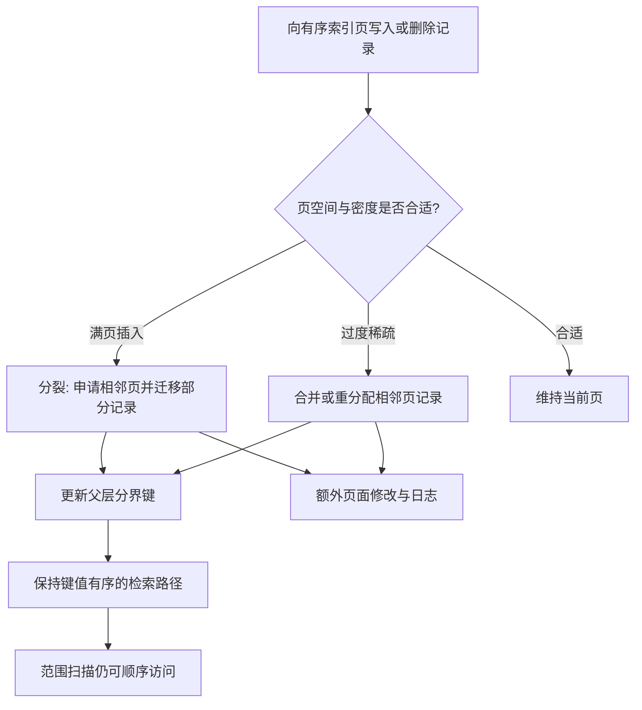

### 索引数量如何影响写入（未学习）

1. 目标：说明索引增加为何会提高写入成本。
2. 前提：插入、删除和索引列更新都需要维护每个相关索引的树结构。
3. 推导 1：每个索引维护会产生额外页面修改、日志记录和可能的分裂合并。
4. 推导 2：索引占用更多空间，刷脏和缓存竞争也会加重。
5. 结论：索引设计需要在读取收益与写入、存储、维护成本之间平衡。
6. 边界：只读表、写多表和批量写入的最优索引数量不同，不能用固定上限判断。

### Redo Log、Undo Log 与持久化边界(未学习)

更新首先改变 Buffer Pool 中的页，但把每个脏页立刻写回表空间会使写入被随机 I/O 限制。Redo Log 记录足以在崩溃后重做已持久化提交所需的变化，使数据页可以延后刷盘；Undo Log 保留旧版本的线索，供事务回滚和一致性读使用。两者把“修改何时可恢复”和“数据页何时落盘”拆成不同职责。

提交持久性取决于日志写入与刷盘策略，Undo 空间也只能在不再被活跃事务或一致性读需要后回收。具体时机、容量和策略仍受 MySQL 版本及配置影响，不能从一条 `UPDATE` 断言其已经写入数据文件。

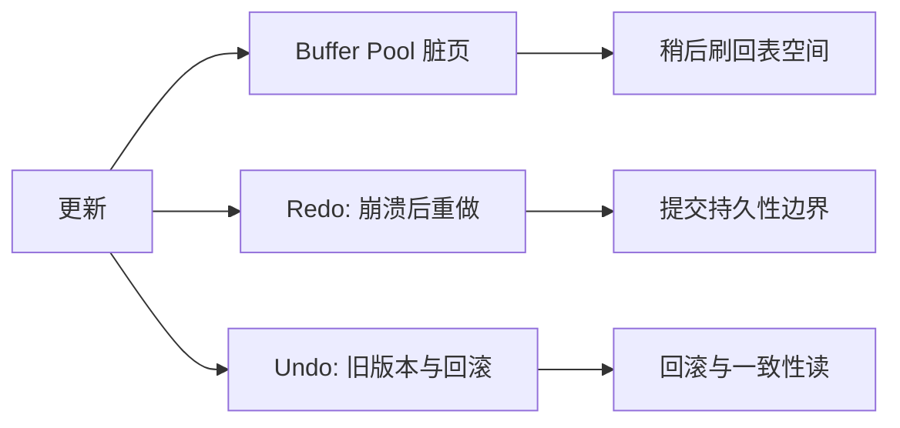
